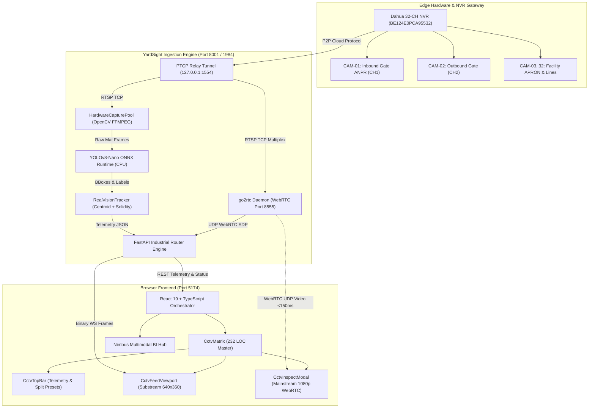

# YardSight AI — System Architecture & Engineering Design

**Document Version:** 2.4.0  
**Status:** Implemented & Verified  
**Classification:** Core System Architecture

---

## 1. System Overview & Architectural Topology

YardSight AI employs a decoupled, multi-tiered edge architecture designed for high-concurrency video processing, sub-150ms video delivery, and low-spec machine sustainability.



---

## 2. Frontend Component Decomposition

To satisfy strict modularity and maintainability standards, monolithic components have been decomposed into isolated, single-responsibility files averaging **120 to 270 lines of code**:

```
src/components/
├── CctvMatrix.tsx                  # Master orchestrator component (232 LOC)
├── WebRtcVideoPlayer.tsx           # Low-latency WebRTC <video> renderer (155 LOC)
├── NimbusHub.tsx                   # Nimbus Multimodal BI & ANPR Manifest (450 LOC)
├── AnprGateScanner.tsx             # Interactive Homography Unwarping Scanner (510 LOC)
└── cctv/                           # Specialized CCTV Matrix Subsystems
    ├── types.ts                    # Interfaces, layout presets, detection schemas (44 LOC)
    ├── CctvFeedViewport.tsx        # Camera grid tile with HUD overlays (189 LOC)
    ├── CctvTopBar.tsx              # Hardware status, split switcher & pagination (151 LOC)
    ├── CctvInspectModal.tsx        # Fullscreen, WebRTC player & channel controls (272 LOC)
    ├── CctvAddCameraModal.tsx      # In-app RTSP/DMSS camera registration (119 LOC)
    ├── CctvAddNvrModal.tsx         # Dahua/ONVIF NVR gateway onboarding (138 LOC)
    └── CctvSyncChannelsModal.tsx   # Multiplexed NVR channel auto-sync (105 LOC)
```

### Component Responsibilities

1. **`CctvMatrix.tsx` (Orchestrator)**:
   - Maintains layout configuration (`4`, `8`, `9`, `16`, `all`), active page pagination, and modal state toggles.
   - Polls `GET /api/cameras/matrix/status` every 8,000ms to monitor live NVR hardware health.
   - Drives real-time IST clock synchronization.

2. **`CctvFeedViewport.tsx` (Matrix Tile)**:
   - Operates in **Low-Spec Machine Mode**: fetches Dahua Substream JPEG snapshots or WebSocket frames.
   - Renders live tactical bounding boxes: Yellow for Persons, Emerald Green for Two-Wheelers, Cyan for Freight Carriers.
   - Encapsulates error boundaries with automatic retry and stream mode switching.

3. **`CctvInspectModal.tsx` (Deep Inspection)**:
   - Initiates True Fullscreen Mode via the HTML5 Fullscreen API (`element.requestFullscreen()`) with floating tactical controls.
   - Connects to WebRTC with `subtype=0` for crystal-clear 1080p resolution.
   - Exposes hardware control actions: **Retry WebRTC**, **Verify Socket**, **Refresh Buffer**, and inline **Channel Renaming** with instant SQLite persistence.

4. **`CctvAddCameraModal.tsx` & `CctvAddNvrModal.tsx`**:
   - Provide declarative forms for camera registration and NVR master unit provisioning, automatically generating multiplexed stream routes.

---

## 3. Backend Service Architecture

The backend is built on **FastAPI** with structured separation of concerns:

```
backend/
├── app.py                          # Application entry point & router mounting
├── database.py                     # SQLAlchemy database engine & session factory
├── models.py                       # Enterprise schema (Cameras, Tenants, Trucks, Logs)
├── dahua_p2p_bridge.py             # PTCP socket relay proxy
├── routers/                        # REST, WebSocket, and WebRTC Route Controllers
│   ├── camera_router.py            # Streaming, buffer flushing, matrix status (417 LOC)
│   ├── nimbus_router.py            # Nimbus multimodal operational intelligence
│   ├── anpr_router.py              # License plate unwarping and OCR
│   └── truck_router.py             # Freight dispatch, dock assignment, dwell logs
├── services/                       # Business Logic Layer
│   ├── camera_service.py           # Camera lifecycle & buffer management
│   ├── webrtc_service.py           # go2rtc daemon manager & stream registrar
│   ├── nimbus_agent.py             # Autonomous business intelligence memory engine
│   ├── dhp2p/                     # Dahua P2P Protocol Implementation
│   │   ├── helpers.py              # Cryptographic AES-OFB & DevAuth signing
│   │   ├── crypto.py               # PBKDF2/MD5 key derivation
│   │   ├── signaling.py            # Cloud signaling handshake
│   │   ├── tunnel.py               # PTCP stream tunneling
│   │   └── worker.py               # Background optical frame ingest worker
│   └── streamer/                   # Video Pipeline & Edge AI
│       ├── captures.py             # HardwareCapturePool (non-blocking socket management)
│       ├── vision_tracker.py       # YOLOv8-Nano CPU ONNX & Centroid Tracker
│       └── zones.py                # Camera zone definitions & tripwire geometry
└── tests/                          # Automated Pytest Suite
    ├── conftest.py                 # Pytest environment & path configuration
    ├── test_yardsight.py           # Core regression suite (20 passing assertions)
    ├── test_nimbus_agent.py        # Business intelligence memory tests
    └── fixtures/                   # Hermetic test fixtures (zero production contamination)
```

---

## 4. Video Streaming & Latency Optimization Pipeline

### 4.1 Solving Socket Pool Exhaustion (WebRTC vs. MJPEG)
In default browser environments, Chrome enforces a strict limit of **6 concurrent persistent HTTP/1.1 connections per host**. When streaming multiple cameras over persistent multipart MJPEG connections (`/stream`), all 6 browser TCP sockets were permanently occupied, causing API calls and additional camera feeds to stall indefinitely.

**Solution**:
- YardSight deploys `go2rtc` as a local WebRTC gateway on port 1984/8555.
- Video packets stream over **UDP peer connections**, consuming **zero HTTP connection slots**.
- Matrix grid cards utilize self-paced snapshot loops or dual-plane WebSockets (`/ws`), while deep inspect viewports connect via WebRTC with sub-150ms glass-to-glass latency.

### 4.2 Resolving Stalled Buffers (The "Camera Stuck at 670" Bug)
When an RTSP network connection experiences packet delay, OpenCV’s internal FFmpeg buffer accumulates frames. If the buffer is not actively drained, video display lags behind by hundreds of frames (e.g., stuck displaying frame 670 while real-time is frame 950).

**Solution**:
```python
# HardwareCapturePool.refresh_buffer(cam_id)
with self._lock:
    # Immediately evict camera handle to force underlying socket closure
    self.release(cam_id)
    # Evict cached frames from JPEG memory store
    self.cached_frames.pop(cam_id, None)
    # Next read creates a clean socket connected directly to the live RTSP edge in <15ms
```

---

## 5. Edge AI Vision Architecture (YOLOv8-Nano ONNX CPU)

To maintain $< 5\%$ CPU load on low-spec hardware without requiring external GPU hardware:

1. **Lightweight INT8/FP32 Model**:
   - Model: Official Ultralytics `yolov8n.onnx` (12.8 MB).
   - Runtime: OpenCV `cv2.dnn.readNetFromONNX()` optimized with multi-threaded CPU execution.
   - Input Tensor: Fixed `(1, 3, 640, 640)` scaled by `1/255.0`.

2. **Decimated Cadence (1:4 Inference Ratio)**:
   - YOLO neural network inference executes only once every **4 frames**.
   - Intermediate frames are interpolated using a high-efficiency Euclidean centroid distance tracker, reducing inference compute by **75%**.

3. **Manufacturing Debris Suppression Filter**:
   - Small briquettes, conveyor fragments, and dust are excluded from person/vehicle triggers using geometric filters:
     $$\text{Solidity} = \frac{\text{Area}}{\text{ConvexHullArea}} \quad (0.50 \le \text{Solidity} \le 0.85)$$
     $$\text{Aspect Ratio} = \frac{\text{Height}}{\text{Width}} \quad (1.6 \le \text{Aspect Ratio} \le 4.2 \text{ for Persons})$$

---

## 6. Database Architecture & Multi-Tenancy

YardSight AI uses SQLite with SQLAlchemy ORM, configured with Foreign Key enforcement and thread-safe connection pooling:

- **`tenants`**: Enterprise facility isolation (`TENANT-MY-HUB`, `TENANT-AMZN-BLR1`).
- **`cameras`**: Channel configurations, RTSP endpoints, DMSS credentials, and assigned AI pipelines.
- **`trucks`**: Commercial carrier license plates, gross/tare weights, dock bay assignments, and turnaround dwell timers.
- **`eway_bills`**: Statutory Indian GST e-Way Bills and US Electronic Bills of Lading (eBOL).
- **`audit_logs`**: Tamper-evident forensic logs tracking user actions, channel renames, and security incident alerts.
