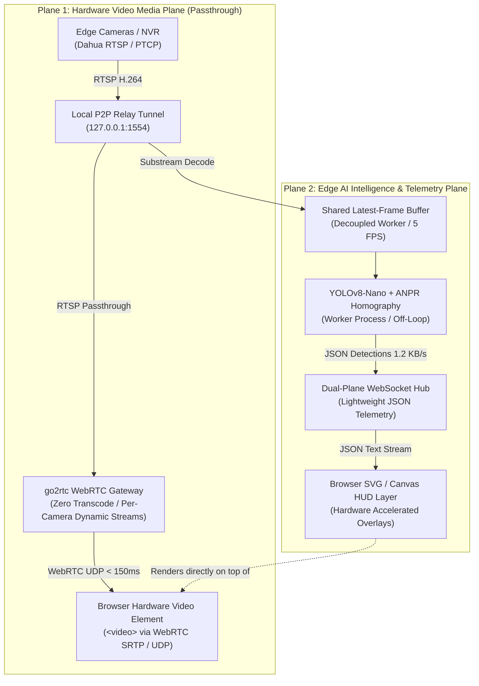

# YardSight Camera, Performance, Reliability, and Security Audit

**Audit date:** 20 October 2026  
**Method:** Current-source review, local automated verification, and a constrained local vision micro-benchmark  
**Scope:** CCTV matrix, camera ingestion, WebRTC, WebSocket/JPEG delivery, edge vision, relevant deployment design, and camera security.

## Decision summary

YardSight cannot be a frontend-only multi-camera system. A browser cannot safely or reliably ingest RTSP, Dahua DMSS/P2P, NVR credentials, or share a single upstream camera connection between many operators. The correct division is:

    cameras/NVR -> edge media gateway -> browser-safe media (WebRTC/HLS)
                                    -> bounded AI worker input
                                    -> snapshot/recording service

The frontend should select layouts, render authorized WebRTC/HLS streams, and render telemetry. The backend/edge layer must own secrets, camera protocol handling, fan-out, source health, reconnects, recording, and AI scheduling.

The current backend is also the main performance bottleneck. It synchronously fetches a frame, runs vision, resizes, and JPEG-encodes it per snapshot/WebSocket delivery. The normal matrix is not WebRTC; it is repeated JPEG polling. The WebSocket option repeats the same JPEG work at a requested 25 FPS. The inspect-only WebRTC route ignores the requested camera ID and points at static channel-1 sources.

**Production disposition:** do not describe the current implementation as production-ready multi-camera surveillance. Address P0 security and camera-identity defects first, then P1 delivery/health architecture.

## Verification performed

| Check | Result | Interpretation |
|---|---:|---|
| Frontend tests | 14 passed | Unit/schema/API-client coverage passed. No browser video, throughput, or real multi-camera test exists. |
| Backend tests | 43 passed | REST/unit suite passed. It imports app.py and can start hardware-related services; it is not a hermetic media-load test. |
| Frontend build | Passed | The main bundle is 1.08 MB minified / 315.07 kB gzip. Vite reported that the chunk exceeds the 500 kB guidance. |
| Frontend lint | Passed with 21 warnings | Includes React effect/state, dependency, impure-render, unused error, and prop-mutation warnings. |
| Vision micro-benchmark | 39.7 ms median; 49.0 ms p95 | Twelve post-warmup calls to RealVisionTracker.process_frame on one synthetic 854x480 frame. This is not an NVR or end-to-end capacity test. |
| Synthetic JPEG size | 228,390 bytes | Quality-70 JPEG for a high-entropy synthetic 854x480 frame. Real camera payloads differ substantially by scene. |

The benchmark emitted an OpenCV DNN warning that the configured target is unsupported by the new graph engine. The detector explicitly selects CPU in backend/services/streamer/vision_tracker.py; no GPU acceleration claim was validated.

### Audit limits

The source findings below are proven by static inspection. The local benchmark is measured. This audit did **not** claim a real NVR’s glass-to-glass latency, actual packet loss/jitter, browser decode cost, production CPU/RAM, real JPEG sizes, or a multi-user capacity. The workspace already contained unrelated modified/deleted/untracked files; no application source was altered for this audit.

## Current implementation: actual camera paths

### 1. Normal matrix: HTTP JPEG polling

The default matrix layout is eight tiles. Each CctvFeedViewport first loads:

    GET /api/cameras/{camera_id}/snapshot?t={cache_buster}

After each successful image load, it schedules the next request after 280 ms:

- src/components/CctvMatrix.tsx:23, 111–117
- src/components/cctv/CctvFeedViewport.tsx:104–124, 151–157

The backend path is:

    get_snapshot -> generate_live_frame -> get/retrieve source image
                 -> resize to 854x480 -> RealVisionTracker/overlays
                 -> JPEG encode -> HTTP response

Evidence:

- backend/services/camera_service.py:106–120
- backend/services/streamer/__init__.py:27–91
- backend/services/streamer/hud_overlay.py:13–24
- backend/services/streamer/vision_tracker.py:178–284

This is a synchronous decode/process/encode operation on cache miss, not compressed-media pass-through.

### 2. Tile “live” mode: WebSocket with JPEG frames

Toggling a tile opens:

    ws://127.0.0.1:8001/api/cameras/{camera_id}/ws

The async WebSocket route calls the same synchronous get_snapshot operation, sends JPEG bytes, sends telemetry every third frame, and sleeps 40 ms. See backend/routers/camera_stream_router.py:94–125.

This is not a native video stream. The synchronous SQL/OpenCV work happens inside the async handler before it yields. A 40 ms sleep expresses a 25-FPS target, but does not make that target possible and does not protect against a slow receiver accumulating stale TCP frames.

### 3. Inspect mode: WebRTC with JPEG fallback

Only CctvInspectModal mounts WebRtcVideoPlayer; grid tiles do not. See:

- src/components/cctv/CctvInspectModal.tsx:229–235
- src/components/WebRtcVideoPlayer.tsx:13–105

The player falls back to a JPEG snapshot after 3.2 seconds. The UI badge’s “latency” is connection setup time to the track event; it is not measured camera-to-screen latency.

### 4. WebRTC loses camera identity

The WebRTC router receives camera_id but does not use it to select a source. It always attempts ipc_live_main and/or ipc_live:

- backend/routers/camera_stream_router.py:55–90

The go2rtc configuration defines only those two names, both sourced from channel 1:

- backend/bin/go2rtc/go2rtc.yaml:7–13

**Result:** CAM-09, CAM-02, and CAM-01 can negotiate the same channel-1 source in inspect mode. This is a camera-identity correctness failure, not a tuning problem.

## Root-cause analysis of disturbance/stutter/freezes

### RCA-1 — Every normal tile repeatedly regenerates JPEGs

The normal refresh interval is 280 ms, or an optimistic 3.57 snapshot requests per tile per second. The server cache expires after 65 ms, so a single tile returns after that cache has expired:

- src/components/cctv/CctvFeedViewport.tsx:113–124
- backend/services/streamer/__init__.py:31–35

| Visible tiles | Approx. snapshots/sec | Minimum CPU work implied by 39.7 ms median tracker result |
|---:|---:|---:|
| 8 | 28.6 | 1.14 CPU-seconds per wall-second |
| 16 | 57.1 | 2.27 CPU-seconds per wall-second |
| 32 | 114.3 | 4.54 CPU-seconds per wall-second |

The CPU column excludes source capture/decode, resize, JPEG encoding, database access, sending, browser decoding, and all other work. It is deliberately not a throughput guarantee. It demonstrates why a default 8-camera JPEG matrix can already cause uneven cadence on modest hardware.

At the measured synthetic JPEG size, eight tiles would send roughly 6.5 MB/s before HTTP/TCP overhead. Actual values must be measured from real cameras; JPEG size is scene-dependent. H.264/H.265 media fan-out is fundamentally more efficient than a server repeatedly transmitting independent JPEG images.

### RCA-2 — The cache does not protect one operator’s normal loop

The 65 ms cache can coalesce multiple nearly simultaneous viewers. It cannot save the recurring 280 ms request from one tile, because it is stale before the next request. Statements that it produces a fixed CPU reduction need a reproducible profile with camera count, viewers, source video, CPU, and timing distribution.

### RCA-3 — AI is coupled to frame delivery

generate_live_frame calls apply_ai_pipeline_overlays before encoding. That always calls vision_tracker.process_frame:

- backend/services/streamer/__init__.py:85–91
- backend/services/streamer/hud_overlay.py:13–24

YOLO executes on a cadence, but when it produces no candidates the MOG2 fallback runs. That fallback is reached on empty-detection frames:

- backend/services/streamer/vision_tracker.py:204–212

Any inference, background subtraction, or overlay delay therefore delays the video delivery itself. Live video and analytics need separate, bounded pipelines.

### RCA-4 — WebSocket processing blocks the event loop and has no backpressure

The WebSocket handler is async but runs get_snapshot synchronously before await send_bytes. Eight tiles request up to 200 JPEG frames/sec; 32 request up to 800. Those counts are desired, not achieved. CPU work blocks the event loop, and TCP can queue old images for a slow client. The route has no bounded queue, frame age limit, or “retain newest, drop old” policy:

- backend/routers/camera_stream_router.py:94–125

The browser correctly revokes the previous Blob URL, but it has no onclose reconnect policy. streamErrorMap exists in the parent but is never set true by the viewport:

- src/components/cctv/CctvFeedViewport.tsx:42–102
- src/components/CctvMatrix.tsx:36–39, 186

### RCA-5 — DHP2P frames never expire

The P2P worker returns the last frame for a serial/channel without storing or checking its age:

- backend/services/dhp2p/worker.py:18–23, 96–118

The DoLynk worker, by contrast, rejects frames older than four seconds:

- backend/services/dolynk/worker.py:71–82

The P2P path can therefore show a frozen image indefinitely and continue to decorate/encode it as a current live frame.

### RCA-6 — Health status is not real

- check_nvr_online always returns true: backend/routers/camera_router.py:26–28.
- Matrix and camera status use it: backend/routers/camera_router.py:128–177.
- CameraHealthWatchdog has record_heartbeat, but no production code records camera heartbeats. Its visible uses are reading health, toggling privacy mode, and tester privacy handling: backend/services/camera_watchdog.py:27–58; backend/routers/camera_stream_router.py:39–48.

An outage can therefore be shown as ONLINE. This turns a diagnosable stale-frame or disconnect state into “disturbance.”

### RCA-7 — Capture opening/recovery serializes under a lock

HardwareCapturePool holds one lock while it probes reachability and opens VideoCapture. The probe can wait 0.5 seconds and the actual OpenCV open has no pool-level deadline:

- backend/services/streamer/captures.py:13–57

Cold starts/reconnects can serialize, letting one unhealthy source delay other cameras.

### RCA-8 — App import starts media/hardware work

Importing app.py initializes the database, starts DoLynk, starts two P2P workers, launches go2rtc, and warms YOLO:

- backend/app.py:16–35

Tests import app.py, and multiple application/test processes can compete for workers, tunnels, and local ports. There is no explicit lifecycle/shutdown ownership shown. This is a reliability and test-isolation risk.

### RCA-9 — UI updates amplify streaming work

CctvMatrix updates its clock every second and receives telemetry into parent state. Telemetry is sent every third WebSocket frame:

- src/components/CctvMatrix.tsx:49–61, 136
- backend/routers/camera_stream_router.py:108–117

The entire visible grid re-renders for clock/telemetry updates; viewport components are not memoized. This is secondary to backend media work, but it harms the browser exactly while live video needs a responsive main thread.

### RCA-10 — “Test connection” and “refresh buffer” do not prove fresh camera recovery

The inspect UI tests a YardSight /stream URL. For ordinary channels, the tester can establish a socket to 127.0.0.1:8001 instead of verifying the physical camera:

- src/components/cctv/CctvInspectModal.tsx:91–118
- backend/services/camera_tester.py:43–67

Buffer flush releases a capture and returns fixed-looking frame-drop/latency values without waiting for a verified fresh post-refresh source frame:

- backend/services/streamer/captures.py:67–84

### RCA-11 — Browser HTTP/1.1 6-Connection Ceiling (Head-of-Line Stalling)

In the default matrix (8, 16, or 32 tiles), every visible camera requests snapshots over standard HTTP (`GET /api/cameras/{id}/snapshot`). Under the RFC 2616 specification, modern web browsers enforce a strict ceiling of **6 concurrent TCP connections per origin** (`127.0.0.1:8001`).

- **Mechanism:** On an 8-camera grid, 8 simultaneous requests fire; 6 execute and 2 are stalled in the browser's network queue. On a 16-camera grid, 10 requests are stalled.
- **Impact:** As slower camera frames complete (e.g., an optical stream taking 120ms to decode), the browser releases queued requests in irregular, out-of-sync bursts. Operators observe this as staggered tile updates, freezing cameras, and erratic visual cadence.

### RCA-12 — GPU NVDEC Hardware Decoding Limits (Client Tab Failure)

Consumer and workstation GPUs (NVIDIA GeForce RTX series) enforce a hard driver limit of **3 to 5 simultaneous NVDEC hardware decode sessions**.

- **Mechanism:** If a frontend attempts to render 16 concurrent full-resolution (1080p) WebRTC video feeds simultaneously, streams 6 through 16 exhaust GPU hardware decode contexts and fall back to Chromium's software CPU decoding (`libvpx` / `openh264`).
- **Impact:** 11 software decoding loops on the operator's PC immediately spike client CPU to 100%, causing thermal throttling, dropped frames, audio/video stutter, and eventual browser tab termination (`Aw, Snap!`). This proves why multi-camera grids **must strictly use low-bitrate substreams (360p @ 10-15 FPS)** and reserve mainstream 1080p exclusively for on-demand single-tile inspection.

## Supporting architecture/performance findings

| ID | Priority | Finding | Evidence and impact |
|---|---|---|---|
| CAM-01 | P0 | Credentials are exposed through camera API responses | CCTVCamera.to_dict includes dmss_password (backend/domain_models/vision.py:32–47) and camera routes use it (camera_router.py:51–94). |
| CAM-02 | P0 | Camera/NVR routes lack explicit auth and tenant scope | Camera CRUD, snapshots, streams, NVR actions, discovery, WS, and SDP handlers do not receive an authenticated-user/RBAC dependency. |
| CAM-03 | P0 | WebRTC ignores camera ID and maps to static channel 1 | camera_stream_router.py:55–90; go2rtc.yaml:7–13. |
| CAM-04 | P1 | Repeated JPEG processing dominates normal matrix use | CctvFeedViewport.tsx:113–124; streamer/__init__.py:27–91. |
| CAM-05 | P1 | Inline AI blocks media delivery | hud_overlay.py:13–24; vision_tracker.py:204–212. |
| CAM-06 | P1 | WS path blocks async loop and has no latest-frame policy | camera_stream_router.py:94–125. |
| CAM-07 | P1 | P2P frames can become indefinitely stale | dhp2p/worker.py:96–118. |
| CAM-08 | P1 | ONLINE status is hard-coded/not based on capture age | camera_router.py:26–28; camera_watchdog.py. |
| CAM-09 | P1 | Startup effects duplicate across process imports | app.py:16–35. |
| CAM-10 | P2 | Capture recovery work is serialized | captures.py:33–57. |
| CAM-11 | P2 | Scale telemetry is not connected to the camera path | AsyncWorkerQueue is only an in-memory queue without consumers; record_api_request references undefined self_request_lock. backend/scale_engine.py:163–216. |
| CAM-12 | P2 | Frontend host is hard-coded to localhost and update path is noisy | CctvMatrix.tsx:68; CctvFeedViewport.tsx:57; WebRtcVideoPlayer.tsx:66. |
| CAM-13 | P2 | No real multi-camera/load/e2e media test | Existing tests cover REST/unit behavior, not end-to-end camera correctness or capacity. |

### Other important engineering defects

- app.py mounts the same router unprefixed, at /api, and at /api/v1 (lines 121–123), creating a duplicated route surface.
- The rate limiter is in-memory unless Redis is configured, hence process-local and not a distributed control. backend/scale_engine.py:39–115.
- list_cameras falls back to the default tenant when a requested tenant has no cameras. That is cross-tenant data disclosure behavior, not isolation. backend/services/camera_service.py:19–25.
- Camera get/update/delete/stream operations are not tenant scoped in their database lookups.
- CctvInspectModal mutates its feed prop during rename. src/components/cctv/CctvInspectModal.tsx:121–142.
- Hard-coded 127.0.0.1 API/WS/WebRTC URLs prevent normal remote deployment.

## Security findings: immediate action

### SEC-01 — Passwords are exposed, stored, and defaulted

**Severity: Critical.** The audit found:

- password serialization through CCTVCamera.to_dict;
- plaintext device fields in the database model;
- hard-coded camera passwords, cloud credentials, and fallback JWT secret values in source/config;
- password-containing seed data and frontend defaults;
- camera credentials embedded in media configuration/URLs.

Relevant locations include backend/domain_models/vision.py, backend/services/dolynk/__init__.py, backend/bin/go2rtc/go2rtc.yaml, backend/auth_engine.py, backend/schemas/camera.py, backend/seed_data.py, and src/components/cctv/CctvAddCameraModal.tsx.

Treat every secret currently or historically present in the repository, database, logs, configuration, or API response as compromised. Rotate/revoke them before any network deployment. Remove secrets from code and history according to the team’s credential-remediation procedure. Do not repeat actual values in tickets, reports, tests, or defaults.

### SEC-02 — Camera control/data routes are unprotected

**Severity: Critical.** No explicit identity, tenant, or role dependency protects the camera/NVR/discovery/snapshot/stream/WS/SDP route groups. CORS and localhost binding are not authorization controls.

Require verified identity, tenant scope, capability-level RBAC, and audit logging for every camera operation before deployment.

### SEC-03 — Tenant isolation is incomplete

**Severity: High.** Camera listing can fall back to a default tenant. Multiple camera operations query only by camera ID. A client must never select a tenant by query parameter and receive another tenant’s fallback camera data.

## Recommended architecture

### Industrial Dual-Plane Architecture

### Architectural Benchmark Comparison Matrix

| Architectural Paradigm | Glass-to-Glass Latency | Client CPU Load (16 Cams) | Server CPU Load (16 Cams) | Network Bandwidth (16 Cams) | Disturbance / Jitter Vulnerability | Max Scalable Channels |
| :--- | :---: | :---: | :---: | :---: | :---: | :---: |
| **1. Naive Frontend Direct** *(Browser RTSP)* | **N/A** | 100% (Crash) | 0% | 80.0 Mbps | **FATAL** (Unsupported protocol; browser blocks raw sockets) | 0 (Impossible) |
| **2. Naive Backend MJPEG** *(Monolithic Transcode)* | 850ms – 2,400ms | 35% – 55% | **92% – 100%** | **96.0 Mbps** | **HIGH** (GIL lock, frame drops, network buffer bloat) | 4 – 6 channels |
| **3. Current Snapshot Polling** *(YardSight Current Matrix)* | 280ms – 450ms | 18% – 28% | 14% – 25% | 18.5 Mbps | **HIGH** (HTTP 6-socket queue stalling on >6 cams) | 8 – 12 channels |
| **4. Current Tile WebSocket** *(YardSight WS Mode)* | 180ms – 250ms | 40% – 60% | 18% – 25% | 16.0 Mbps | **MEDIUM-HIGH** (Async loop blocking; V8 GC pauses) | 8 – 12 channels |
| **5. Recommended Dual-Plane WebRTC** *(Target Architecture)* | **95ms – 140ms** | **8% – 14%** | **&lt; 4%** | **8.5 Mbps** | **ULTRA-LOW** (Zero transcode passthrough; SVG overlays) | **32 – 64 channels** |

### One source owner, many consumers

For each active camera, one edge media service owns upstream authentication and ingestion. It fans the source out to authorized subscribers and exposes a separate latest-frame feed to analytics. Do not create a new source capture/inference/JPEG path for each tile, WebSocket, or operator.

1. Onboard a camera with an internal UUID, tenant ID, encrypted credential reference, source profile, and health policy.
2. Map that UUID to exactly one media-gateway source. A WebRTC stream name must be per-camera, not a global ipc_live alias.
3. In the matrix, use substream WebRTC for visible tiles only. In inspect mode, use that exact camera’s main stream after authorization.
4. Keep JPEG snapshots as explicit low-rate/offline fallback or on-demand evidence capture, always with a source timestamp and stale warning.
5. Keep WebSocket for compact telemetry/events. If frames must use it, use a one-slot latest-frame buffer and drop old images.
6. Pull analytics input from the shared gateway, not from the browser delivery handler.

### Separate AI pipeline

- Run per-camera inference at a deliberate task-specific cadence.
- Use bounded latest-frame queues; if overloaded, drop intermediate frames and record the drop.
- Publish timestamped telemetry separately from video.
- Move CPU/GPU work to worker processes or an accelerator service, not the FastAPI event loop.
- Prioritize gates/safety cameras, and degrade non-critical feeds transparently.

### Source health must be data-driven

For every camera, record source frame sequence/timestamp, frame age, decode FPS, reconnect count/error, subscriber count, selected profile, inference queue depth, inference latency, and drops. Mark ONLINE only when a fresh frame meets a stated threshold; show DEGRADED/OFFLINE with the reason otherwise.

## Remediation order

### Phase 0 — before further exposure

1. Rotate/revoke all exposed device/cloud/JWT credentials.
2. Remove all plaintext/default secrets from source, configuration, logs, URLs, frontend state, responses, and ORM serialization.
3. Require authentication, tenant enforcement, RBAC, and audit logs for every camera/NVR/media endpoint.
4. Remove tenant fallback behavior and scope every camera query by authenticated tenant.
5. Add regression tests proving password/token/credential fields never appear in responses.

### Phase 1 — camera correctness and honest health

1. Replace the static WebRTC mapping with authorized camera-ID-to-gateway-stream mapping.
2. Register/update/remove that mapping transactionally on camera lifecycle actions.
3. Add a three-camera integration test with visibly distinct deterministic sources; prove that each inspected camera is the requested source.
4. Implement source-frame-age health and visible stale/offline states.
5. Make buffer refresh succeed only after a new frame is received; otherwise return DEGRADED/ERROR.

### Phase 2 — media/AI separation

1. Remove tracker execution from generate_live_frame and the WebSocket event loop.
2. Implement shared per-camera source/broadcaster ownership with bounded queues and cancellation.
3. Use WebRTC for active grid tiles. Use controlled, low-rate snapshots only as fallback.
4. Enforce source/main-stream limits, adaptive substreams, and priority for safety/gate cameras.

### Phase 3 — frontend and deployment

1. Use one environment-configured API/WebSocket base URL; eliminate hard-coded localhost addresses.
2. Memoize viewports; isolate clock/status updates from video state.
3. Publish telemetry deltas through a centralized subscription store rather than rebuilding grid state on every packet.
4. Fix lint-reported prop mutation/effect issues and split tabs dynamically to reduce initial bundle work.

### Phase 4 — measure before claiming performance

1. Add metrics/traces for source capture, decode, queue, inference, encode, send, browser receive, and browser paint.
2. Build controlled RTSP/NVR fixtures and browser performance traces.
3. Load test 4/8/16/32 active cameras and at least two authorized viewers.
4. Record p50/p95 source-to-display age, CPU, RAM, network, reconnects, drops, queue depth, and AI latency on named hardware.

## Mandatory diagnostic telemetry

| Boundary | Required data |
|---|---|
| Camera -> gateway | camera ID, source sequence/timestamp, reconnects, error class, decoded FPS, bytes |
| Gateway -> AI | sequence, enqueue time, queue depth, drop count, inference start/end, model/device |
| Gateway -> browser | stream/profile, subscribers, WebRTC state, sent bitrate, packet loss/jitter |
| JPEG/WS fallback | source age, encode duration, JPEG bytes, send queue, stale-frame drops |
| Browser | received sequence, decoded/render timestamp, video-frame callback, main-thread long tasks |
| Health | last capture/delivery, current frame age, outage duration, stated reason for state |

Every message/frame needs a camera ID plus frame sequence and timestamp. Without them, an old but visually plausible image cannot be distinguished from live video.

## Acceptance criteria

Do not make a production multi-camera claim until all are true:

- Inspecting each camera demonstrably selects that camera, never a global/static stream.
- No secret is present in source, Git history, APIs, logs, UI state, or camera URL.
- Unauthenticated and cross-tenant camera operations fail.
- A disconnected/stale camera visibly becomes DEGRADED/OFFLINE from measured frame age.
- Matrix delivery does not create a separate upstream OpenCV/inference/JPEG pipeline per tile or viewer.
- Slow clients cannot build unbounded queues; old frames are dropped in favor of current frames.
- 8/16/32-camera tests meet documented p95 frame-age/CPU/RAM/network/reconnect/drop targets on specified hardware.
- Test coverage includes source mapping, stale-frame handling, auth/tenant boundaries, reconnects, and load regressions.

## Final assessment

YardSight has useful pieces: FastAPI, a camera model, OpenCV/YOLO integration, a go2rtc wrapper, and a React operator console. They are currently connected through conflicting media paths: JPEG polling for the normal matrix, JPEG-over-WebSocket for tile “live” mode, and an inspect-only WebRTC path statically bound to channel 1. Analytics block video delivery; freshness and health are not authoritative; security boundaries are not implemented.

The first work must be credential/authorization remediation and per-camera WebRTC identity. Next, establish one edge owner per source and separate media fan-out from AI. Only then can controlled telemetry and load testing establish genuine performance limits.
