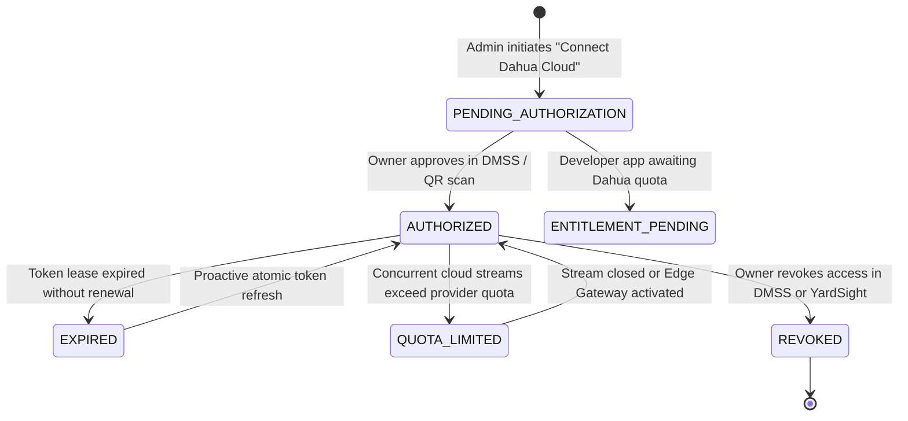
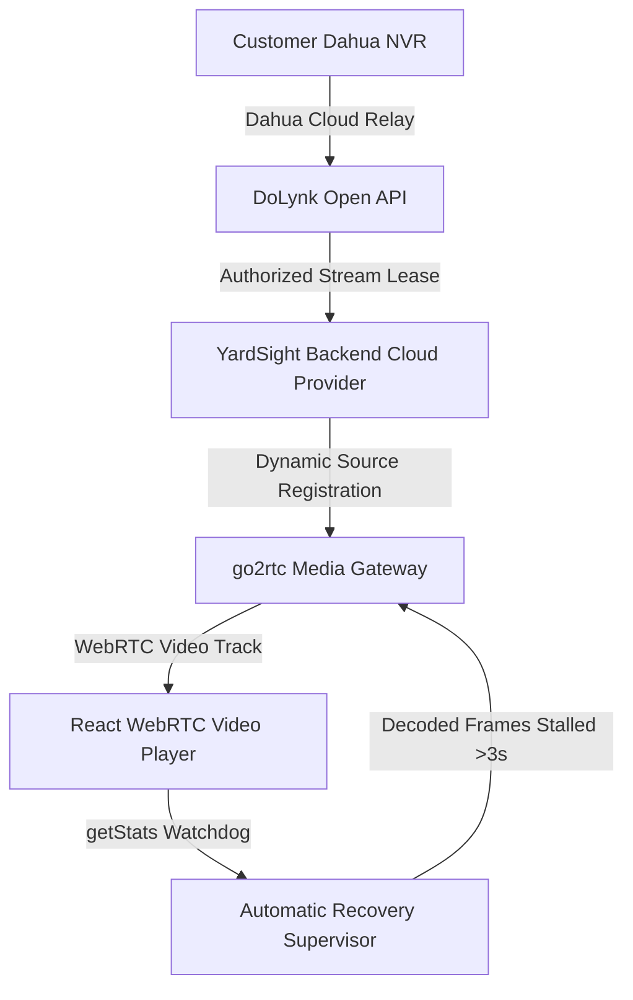

# Dahua DoLynk Cloud Share Integration Specification

**Project:** YardSight AI  
**Author:** Integrity (Implementation Owner)  
**Date:** October 2026  
**Status:** ARCHITECTURAL SPECIFICATION & SECURE CONNECTOR DESIGN

---

## 1. Architectural Principles & Zero-Trust Security

1. **Zero Device Ownership Transfer:** The logistics facility or yard owner retains permanent administrative ownership in Dahua DMSS.
2. **Zero Plaintext Customer Credentials:** YardSight never requests, receives, or persists customer DMSS passwords or administrative logins.
3. **Revocable Least-Privilege Scope:** YardSight requests only `live_view:read` scope for designated facility cameras.
4. **Tenant Isolation:** Every cloud grant, channel mapping, audit entry, and video stream is strictly partitioned by `tenant_id`. Cross-tenant video inspection is blocked at both database and router levels.
5. **DPDP Act (India) Compliance:** All video access events are logged with timestamp, tenant, and accessor identity for statutory data audit compliance.

---

## 2. Customer-Facing Privacy, Ownership & Consent Wording

The following notice is presented to facility administrators during the "Connect Dahua Cloud" workflow:

> ### Dahua DMSS Cloud Share — Customer Ownership & Privacy Notice
> 
> **You Retain Complete Ownership of Your Security Equipment:**  
> Connecting your Dahua NVR to YardSight AI uses Dahua’s official cloud delegation service. At no point does YardSight request your DMSS username or password, nor do you transfer ownership of your physical NVR or cameras.
> 
> **Read-Only Live View Scope:**  
> YardSight requests exclusively read-only Live View permission for the specific channels you approve. YardSight cannot modify your camera configurations, pan/tilt/zoom physical hardware, or access your local NVR hard drive recordings without separate explicit authorization.
> 
> **Instant Revocation at Any Time:**  
> You can disconnect YardSight at any moment through the YardSight settings panel, or directly within your official Dahua DMSS smartphone application under **Device Sharing Settings**. Disconnecting immediately invalidates all active video streaming tokens.
> 
> **Data Processing Notice (DPDP Act, 2023):**  
> Optical video frames are processed in-memory for yard safety, vehicle ANPR, and dwell SLA analytics. In accordance with India's Digital Personal Data Protection Act, YardSight maintains tamper-evident audit logs of all automated and operator video access.

---

## 3. Provider Integration Data Model

### 3.1 `CloudProviderGrant` (Database Entity)
```sql
CREATE TABLE cloud_provider_grants (
    id VARCHAR(64) PRIMARY KEY,
    tenant_id VARCHAR(64) NOT NULL INDEX,
    provider VARCHAR(32) NOT NULL DEFAULT 'DAHUA_DOLYNK',
    provider_device_id VARCHAR(64) NOT NULL,
    authorization_state VARCHAR(32) NOT NULL DEFAULT 'PENDING',
    granted_scopes TEXT NOT NULL,          -- JSON: ["live_view:read"]
    channel_count INTEGER NOT NULL DEFAULT 0,
    created_at TIMESTAMP NOT NULL DEFAULT CURRENT_TIMESTAMP,
    expires_at TIMESTAMP NULL,
    revoked_at TIMESTAMP NULL,
    provider_account_ref VARCHAR(128) NULL, -- Masked owner email/handle
    encrypted_token_ref VARCHAR(256) NULL   -- Vault/reference ID only (never raw secret)
);
```

### 3.2 `CloudProviderAuditLog` (Compliance Entity)
```sql
CREATE TABLE cloud_provider_audit_logs (
    id VARCHAR(64) PRIMARY KEY,
    tenant_id VARCHAR(64) NOT NULL INDEX,
    grant_id VARCHAR(64) NOT NULL INDEX,
    action VARCHAR(32) NOT NULL, -- CONNECT_ATTEMPT, OWNER_APPROVED, SCOPE_CHANGED, SOURCE_ACCESSED, TOKEN_REFRESH, REVOKED
    details TEXT NULL,
    performed_by VARCHAR(64) NOT NULL,
    timestamp TIMESTAMP NOT NULL DEFAULT CURRENT_TIMESTAMP
);
```

---

## 4. Lifecycle State Machine



---

## 5. WebRTC Stream Gateway & Resilience Architecture



1. **Unique Persistent Source Keys:**  
   Every channel receives a dedicated source key in the media gateway:  
   `dahua-{tenant}-{nvr}-ch-{channel:02d}-sub`  
   `dahua-{tenant}-{nvr}-ch-{channel:02d}-main`  
   *Zero channel cross-pollination or frame duplication.*
2. **Upstream Source Sharing:**  
   Multiple dashboard operators or browser tabs viewing Channel 01 attach to the single upstream go2rtc producer, preventing redundant cloud bandwidth consumption.
3. **Inbound WebRTC `getStats()` Health Supervisor:**  
   The React player monitors `framesDecoded` and `bytesReceived`. If video playback freezes for >3 seconds, the peer connection is automatically re-negotiated with exponential backoff without requiring manual user clicks.
