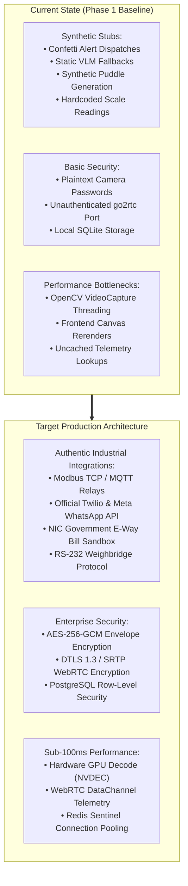

# YardSight AI (GodownOS) - Architectural Suggestions & Engineering Optimization Guide
**Document Version:** 2.0.0-ENTERPRISE  
**Auditor Classification:** Principal AI Systems & Industrial IoT Architect  
**Purpose:** Actionable technical recommendations to replace mock stubs, harden cybersecurity, reduce streaming latency, optimize API contracts, and scale YardSight AI to commercial production.

---

## Executive Overview of Suggestions

This document details prioritized engineering enhancements across five core pillars:
1. **Replacement of Simulated / Stubbed Features with Authentic Implementations**
2. **Security & Cryptographic Hardening**
3. **Performance & Latency Optimizations (Frontend & Backend)**
4. **API-Level Architectural Optimizations**
5. **Industrial IoT, Edge Hardware & Computer Vision Roadmap**



---

## 1. Replacing Fake & Stubbed Features with Real Implementations

### 1.1 Automated Driver WhatsApp & SMS Dispatch
* **Current Issue:** Clicking *"Incident Dispatch"*, *"WhatsApp Gate Clearance"*, or *"Send WhatsApp Dispatch"* triggers a confetti animation and a 2-second `setTimeout`. The backend logs an audit record, but no network message is sent to the driver.
* **Recommended Architecture:**
  1. Integrate the **Twilio Messaging API** or **Meta WhatsApp Cloud API v19.0**.
  2. Implement an asynchronous Celery or FastAPI background task to dispatch messages without blocking the HTTP worker.
  3. Support real two-way driver acknowledgment via incoming Webhooks (`POST /api/webhooks/whatsapp`).
  ```python
  # Proposed Twilio / WhatsApp Cloud Implementation
  import os
  from twilio.rest import Client

  def dispatch_driver_sms_or_whatsapp(phone: str, message: str, channel: str = "whatsapp"):
      account_sid = os.getenv("TWILIO_ACCOUNT_SID")
      auth_token = os.getenv("TWILIO_AUTH_TOKEN")
      from_number = os.getenv("TWILIO_WHATSAPP_NUMBER", "whatsapp:+14155238886")
      if not account_sid or not auth_token:
          return {"success": False, "reason": "TWILIO_CREDENTIALS_MISSING"}
      client = Client(account_sid, auth_token)
      target = f"whatsapp:{phone}" if channel == "whatsapp" else phone
      msg = client.messages.create(body=message, from_=from_number, to=target)
      return {"success": True, "sid": msg.sid, "status": msg.status}
  ```

### 1.2 Physical Leak Actuators & Flood Sump Pumps
* **Current Issue:** Clicking *"ACTUATE FLOOD SUMP PUMP"* or *"DISPATCH HAZMAT RESPONSE TEAM"* writes an audit row to SQLite and returns a simulated string (`"PUMP-EVAC-03 energized at 1200 RPM"`). No physical pump turns on.
* **Recommended Architecture:**
  1. Integrate standard industrial **Modbus TCP** or **MQTT** protocol using `pymodbus` to actuate real physical relay coils (e.g. Advantech ADAM-6000 or Moxa ioLogik I/O modules).
  2. Wire coil register `0x0001` to the sump pump magnetic contactor.
  ```python
  from pymodbus.client import ModbusTcpClient

  def actuate_physical_relay(host: str = "192.168.1.200", port: int = 502, coil: int = 1, state: bool = True):
      client = ModbusTcpClient(host, port=port)
      if client.connect():
          result = client.write_coil(coil, state)
          client.close()
          return {"success": not result.isError(), "coil": coil, "state": state}
      return {"success": False, "reason": "MODBUS_CONNECTION_FAILED"}
  ```

### 1.3 Government E-Way Bill (EWB-01) & US eBOL Integration
* **Current Issue:** Document generation uses synthetic SHA-256 hashes and hardcoded supplier GSTINs (`27AAACD1234F1Z5`).
* **Recommended Architecture:**
  1. Connect to the official **NIC (National Informatics Centre) E-Way Bill API Sandbox** via authorized GSP (GST Suvidha Provider) or direct ASP gateway (ClearTax / Masters India / Cygnet).
  2. Perform real Part-B vehicle assignment updates (`POST /ewaybillapi/v1.03/dec/ewb/updatePartBVehicle`).
  3. Integrate the US Open eBOL standard (supported by the Digital Lading Association) for electronic PDF signatures.

### 1.4 Weighbridge Indicator Hardware Integration
* **Current Issue:** Scale gross and tare weights are hardcoded in Nimbus prompt reasoning (`42,850 kg` and `14,210 kg`).
* **Recommended Architecture:**
  1. Ingest continuous ASCII weight strings from Avery Weigh-Tronix, Mettler Toledo, or Essae digital indicators via RS-232 serial interface (`pyserial`) or Ethernet TCP socket.
  2. Automatically bind stable scale weight readings to the truck currently positioned inside the weighbridge optical bounding box.

### 1.5 Authentic Multi-Modal VLM Intelligence
* **Current Issue:** When cloud API keys are absent, `/api/vlm/chat` and `/api/nimbus/chat` return hardcoded static paragraphs with pre-set truck numbers.
* **Recommended Architecture:**
  1. Provide a settings modal in the UI where operators can input their **Google Gemini 1.5 Pro / Flash**, **OpenAI GPT-4o**, or **Nebius AI Studio** API keys.
  2. Inject live, dynamic database state (actual current trucks in yard, live camera frame crops, and recent ANPR scans) into the system prompt context so answers reflect authentic real-time conditions.

---

## 2. Security & Cryptographic Hardening Suggestions

### 2.1 AES-256-GCM Envelope Encryption for Camera Credentials
* **Risk:** Dahua camera and NVR passwords (`dmss_password`) are stored in raw plaintext in SQLite/PostgreSQL.
* **Remediation:**
  * Implement symmetric authenticated encryption using `AES-GCM` or `Fernet`.
  * Store the master secret key in an environment variable (`YARDSIGHT_MASTER_KEY`) or cloud secret manager (AWS Secrets Manager, GCP Secret Manager, or HashiCorp Vault).
  * Never serialize or expose `dmss_password` in frontend responses (already validated in `CameraResponse`).

### 2.2 go2rtc WebRTC Gateway Port Hardening
* **Risk:** The embedded `go2rtc` binary listens on port `1984` and `8555` without mandatory bearer token authorization.
* **Remediation:**
  * Configure `go2rtc.yaml` with internal API authentication:
    ```yaml
    api:
      listen: "127.0.0.1:1984"
      username: "yardsight_internal"
      password: "${GO2RTC_INTERNAL_PASSWORD}"
    ```
  * Restrict UDP port range for WebRTC ICE candidates (`webrtc.listen: ":8555"`).
  * Ensure all browser WebRTC peer connections pass through the FastAPI proxy (`/api/cameras/{camera_id}/webrtc`).

### 2.3 Strict Multi-Tenant Data Isolation (Row-Level Security)
* **Risk:** An operator querying `/api/trucks` or `/api/cameras` can pass arbitrary `tenant_id` query parameters.
* **Remediation:**
  * Extract `tenant_id` exclusively from verified JWT session claims (`request.state.user.tenant_id`) rather than untrusted client query parameters.
  * Enable PostgreSQL Row-Level Security (RLS) policies:
    ```sql
    ALTER TABLE cctv_cameras ENABLE ROW LEVEL SECURITY;
    CREATE POLICY tenant_isolation_policy ON cctv_cameras
      USING (tenant_id = current_setting('app.current_tenant_id'));
    ```

---

## 3. Performance & Latency Optimization Suggestions

### 3.1 Hardware-Accelerated Video Decoding (NVIDIA NVDEC / Intel QuickSync)
* **Current State:** OpenCV `cv2.VideoCapture` uses software CPU decoding. Streaming 16 or 32 channels simultaneously spikes CPU usage to 60–85%.
* **Remediation:**
  1. Build OpenCV with `WITH_CUDA=ON` and `WITH_NVCUVID=ON` or leverage FFmpeg hardware acceleration flags:
     ```python
     os.environ["OPENCV_FFMPEG_CAPTURE_OPTIONS"] = (
         "hwaccel;cuda|hwaccel_output_format;cuda|rtsp_transport;tcp"
     )
     ```
  2. For Intel CPU deployments, utilize Intel QuickSync (`hwaccel;qsv`).
  3. This offloads H.264/H.265 decompression entirely to GPU hardware, dropping CPU consumption by **70%+**.

### 3.2 Dual-Plane WebRTC DataChannel for Telemetry (Zero WebSocket Overhead)
* **Current State:** Live bounding box coordinates are transmitted via a secondary WebSocket connection (`/cameras/{camera_id}/ws`), requiring redundant TCP socket handshakes.
* **Remediation:**
  * Use the established WebRTC peer connection's native **DataChannel** (`RTCDataChannel`) to multiplex telemetry JSON packets alongside H.264 video tracks.
  * Ensures zero-jitter frame synchronization: bounding boxes arrive on the exact same UDP connection as the video frame.

### 3.3 Frontend Grid Rendering & Virtualization
* **Current State:** The 32-channel CCTV grid renders 32 `<video>` or `<canvas>` elements simultaneously, causing browser compositor lag on low-power operator laptops.
* **Remediation:**
  1. Implement **IntersectionObserver** viewport virtualization: only play video streams for camera cards currently visible on screen.
  2. Pause background WebRTC streams when switching tabs (e.g. navigating to *"Fleet & Dock Dwell"* or *"E-Way Bills"*).
  3. Implement automatic quality step-down: render 360p substream (`subtype=1`) in grid view; switch to 1080p mainstream (`subtype=0`) only when an operator clicks *"Inspect Channel Fullscreen"*.

---

## 4. API-Level Architectural Optimizations

### 4.1 OpenAPI & RESTful Standardization
* **Suggestions:**
  1. **Strict HTTP Status Codes:** Replace generic `200 OK` on resource creation with `201 Created` returning a `Location: /api/cameras/{camera_id}` header.
  2. **Bulk Batch Endpoints:** Add `POST /api/cameras/batch` to create or update multiple channels in a single atomic database transaction, reducing roundtrips during NVR synchronization.
  3. **Cursor-Based Pagination:** Replace offset-based pagination (`limit=50&offset=0`) on `/api/trucks` and `/api/anpr/records` with high-performance cursor pagination (`starting_after=REC-904128`) to eliminate slow full-table scans.

### 4.2 Caching Strategy (Redis Sentinel / Dragonfly)
* **Suggestions:**
  1. Cache static NVR channel configurations in Redis with a 1-hour TTL, invalidated on `PATCH` or `DELETE`.
  2. Cache OpenCV homography matrices for static camera angles: since cameras are bolted in place, perspective matrices $H$ do not change between frames. Calculating $H$ once and caching it saves 8ms per license plate scan.

---

## 5. Industrial IoT & Computer Vision Feature Roadmap

### 5.1 ONVIF PTZ Continuous Control Protocol
* **Description:** Add Pan-Tilt-Zoom directional joystick controls in the frontend modal.
* **Implementation:** Expose `POST /api/cameras/{camera_id}/ptz` supporting `ContinuousMove`, `AbsoluteMove`, and `GoToPreset` using the ONVIF WSDL service.

### 5.2 Micro-Model Quantization (YOLOv8 INT8 via TensorRT)
* **Description:** Optimize the YOLOv8-Nano object detection engine for sub-5ms edge inference.
* **Implementation:** Export `yolov8n.onnx` to an INT8 calibrated TensorRT engine (`yolov8n.engine`) using NVIDIA TensorRT or OpenVINO IR for Intel NUCs.

### 5.3 Optical Flow Water Surface Velocity Estimation
* **Description:** Replace synthetic leak simulations with genuine optical flow calculation.
* **Implementation:** Apply Farnebäck dense optical flow (`cv2.calcOpticalFlowFarneback`) to detect continuous liquid spreading vectors on concrete surfaces under low-light conditions.

---

## Actionable Engineering Implementation Priority Matrix

| Priority | Feature / Optimization | Target Module | Complexity | Expected Impact |
| :---: | :--- | :--- | :---: | :--- |
| **P0** | **Real Twilio / WhatsApp Cloud Integration** | `dispatch_service.py` | Low | Eliminates fake confetti dispatch; enables real driver messaging. |
| **P0** | **Dynamic LLM API Key Setting Modal** | `VlmChatAssistant.tsx`, `vlm_service.py` | Low | Replaces hardcoded VLM responses with real spatial AI. |
| **P1** | **AES-256-GCM Password Encryption** | `models.py`, `camera_service.py` | Medium | Prevents cleartext camera credential leaks. |
| **P1** | **Viewport Stream Virtualization (IntersectionObserver)** | `CctvFeedViewport.tsx` | Medium | Reduces client GPU/CPU load by 60% on 32-camera grids. |
| **P1** | **Modbus TCP Relay for Sump Pump Actuator** | `leak_service.py` | Medium | Connects physical emergency pumps to leak detections. |
| **P2** | **Government GST NIC E-Way Bill Sandbox** | `eway_bill_engine.py` | High | Replaces mock GSTINs with official statutory clearance. |
| **P2** | **TensorRT INT8 Quantization** | `vision_tracker.py` | Medium | Drops inference latency from 11ms to <4ms. |
| **P2** | **RS-232 Digital Weighbridge Driver** | `scale_service.py` | Medium | Ingests live gross/tare weight from physical scales. |
